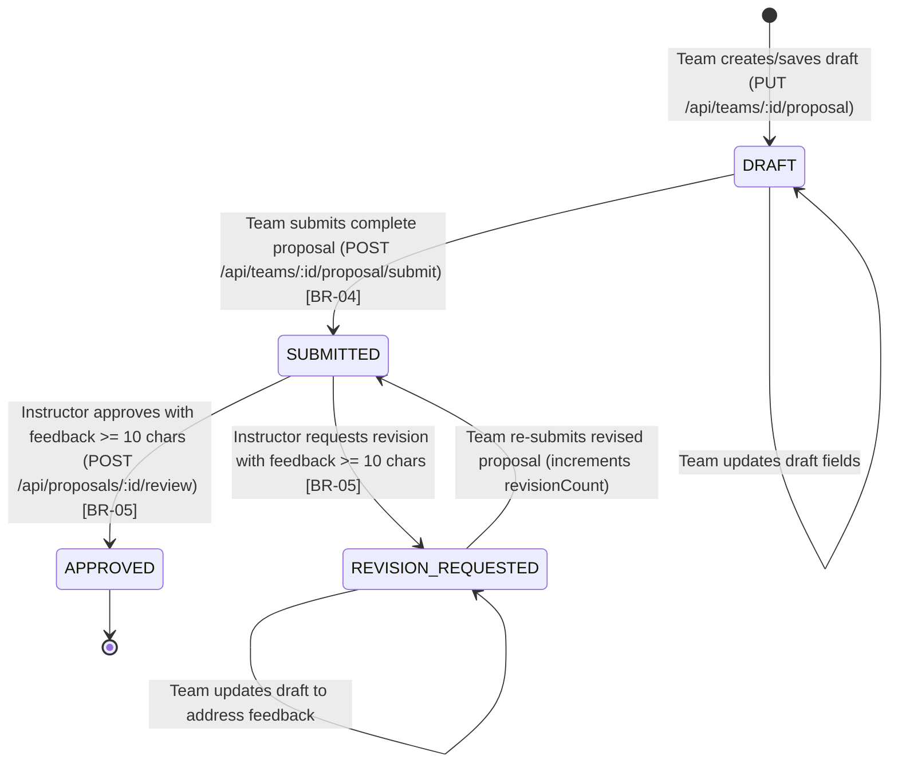

# Part E: Sprint 1 Feature Contracts — F-02 Team Formation & F-03 Proposal Workflow

**Contract Version:** `v1.0` (Prepared prior to Sprint 1 implementation)  
**Feature IDs:** `F-02` (Team Formation & Capacity), `F-03` (Proposal Lifecycle & Instructor Review)  
**Linked Requirements:** `FR-02`, `FR-03`, `FR-04`, `FR-05`, `BR-01`, `BR-02`, `BR-03`, `BR-04`, `BR-05`, `BR-06`, `NFR-01`, `NFR-02`, `NFR-04`  
**Dependencies:** `F-01`

---

## 1. Feature F-02: Course Project Team Formation & Roster Management

### 1.1. Behavior, Workflow, and Business Rules
1. An authenticated `STUDENT` who is not yet in a team for the active course (`CPE334`) can create a new team via `POST /api/teams` by supplying `{ name, courseId }`. The creator is automatically inserted as a `TeamMember` with `memberRole = "LEADER"`.
2. Any existing member of Team $X$ can add an eligible student teammate by email (`POST /api/teams/:id/members` with `{ email }`).
3. **Business Rule `BR-01` (Single Active Team per Course):** If a student already belongs to any team in `courseId`, attempting to create another team or be added to a second team in the same course is rejected with `409 Conflict` (`BR01_DUPLICATE_TEAM_MEMBERSHIP`).
4. **Business Rule `BR-02` (Max Team Size Capacity):** If the target team already has `course.maxTeamSize` members (default `3`), attempting to add another student is rejected with `409 Conflict` (`BR02_MAX_TEAM_SIZE_EXCEEDED`).
5. **Role Restriction (`BR-06`):** Only `STUDENT` users can create or join project teams; `INSTRUCTOR` users attempting `POST /api/teams` receive `403 Forbidden`.

### 1.2. UI, API, and Data Specifications for F-02
- **UI Behavior:** Student Workspace shows either the "Create Team" card (when unassigned) or the "My Team Roster" card showing `members.length / course.maxTeamSize` badge, member list, and "Add Member by Email" input (`data-testid="add-member-email"`).
- **API Endpoints:**
  - `GET /api/courses` → Returns active courses (`id`, `code`, `name`, `term`, `maxTeamSize`).
  - `GET /api/teams?courseId=1` → Returns teams in the course. For a `STUDENT`, includes `myTeam` details and summary roster; for an `INSTRUCTOR`, includes all teams and their full proposal status.
  - `POST /api/teams` → Body: `{ "name": "Team Alpha", "courseId": 1 }`. Returns `201 Created` `{ team }`, or `409 Conflict` on duplicate team name / `BR-01` violation.
  - `POST /api/teams/:id/members` → Body: `{ "email": "tatchakorn@mail.kmutt.ac.th" }`. Returns `200 OK` `{ team }`, or `403`/`404`/`409` (`BR-01`, `BR-02`).
- **Database Schema (`ProjectTeam`, `TeamMember`):**
  - `ProjectTeam`: `id`, `name`, `courseId`, `createdById`, `@@unique([courseId, name])`.
  - `TeamMember`: `id`, `teamId`, `userId`, `courseId`, `memberRole`, `@@unique([courseId, userId])`.

---

## 2. Feature F-03: Project Proposal Drafting, Submission & Instructor Review

### 2.1. Behavior, Workflow, State Machine, and Business Rules

1. **Drafting (`PUT /api/teams/:id/proposal`):** Members of Team `:id` can create or update their proposal draft (`title`, `problemStatement`, `techStack`, `repoUrl`) when status is `DRAFT` or `REVISION_REQUESTED`.
2. **Submission (`POST /api/teams/:id/proposal/submit`):** Transitions proposal to `SUBMITTED`, records `submittedAt`, and increments `revisionCount`.
   - **Business Rule `BR-03` (State Transition Matrix):** Submitting or editing a proposal that is already `SUBMITTED` or `APPROVED` is rejected with `409 Conflict` (`BR03_INVALID_STATUS_TRANSITION`).
   - **Business Rule `BR-04` (Completeness Gate):** Submitting requires `title.trim().length >= 5`, `problemStatement.trim().length >= 20`, and `techStack.trim().length >= 3`. Otherwise rejected with `400 Bad Request` (`BR04_INCOMPLETE_PROPOSAL`).
3. **Instructor Review (`POST /api/proposals/:id/review`):** An `INSTRUCTOR` transitions a `SUBMITTED` proposal to `APPROVED` or `REVISION_REQUESTED`.
   - **Business Rule `BR-05` (Mandatory Feedback & State Check):** Requires `decision` $\in \{\text{APPROVED}, \text{REVISION\_REQUESTED}\}$, `reviewFeedback.trim().length >= 10` (`400 Bad Request` if shorter), and current status must be `SUBMITTED` (`409 Conflict` if `DRAFT` or already `APPROVED`).
4. **Ownership & Role Authorization (`BR-06`):**
   - A `STUDENT` who is **not** a member of Team `:id` attempting `GET`, `PUT`, or `POST /api/teams/:id/proposal*` is rejected with `403 Forbidden` (`BR06_FORBIDDEN_TEAM_ACCESS`) without returning private proposal data.
   - Any `STUDENT` attempting `POST /api/proposals/:id/review` is rejected with `403 Forbidden` (`BR06_INSTRUCTOR_ROLE_REQUIRED`).

### 2.2. UI, API, and Data Specifications for F-03
- **UI Behavior:**
  - **Student Proposal Editor:** Inputs for `title`, `problemStatement`, `techStack`, `repoUrl`, status badge (`data-testid="proposal-status"`), **Save Draft** button (`data-testid="save-draft-btn"`), **Submit Proposal** button (`data-testid="submit-proposal-btn"`), and Instructor Feedback alert (`data-testid="review-feedback-box"`).
  - **Instructor Review Console:** Table of all teams and proposals, filter by status, and Review Panel (`data-testid="review-feedback-input"`, **Approve Proposal** button `data-testid="approve-proposal-btn"`, **Request Revision** button `data-testid="revision-proposal-btn"`).
- **API Endpoints:**
  - `GET /api/teams/:id/proposal` → Protected (`Team Member` or `INSTRUCTOR`). Returns `200 OK` `{ proposal }`.
  - `PUT /api/teams/:id/proposal` → Protected (`Team Member` only). Body: `{ title, problemStatement, techStack, repoUrl }`. Returns `200 OK` `{ proposal }`.
  - `POST /api/teams/:id/proposal/submit` → Protected (`Team Member` only). Returns `200 OK` `{ proposal }` (`status: "SUBMITTED"`).
  - `POST /api/proposals/:id/review` → Protected (`INSTRUCTOR` only). Body: `{ "decision": "APPROVED" | "REVISION_REQUESTED", "reviewFeedback": "..." }`. Returns `200 OK` `{ proposal }`.

---

## 3. Acceptance Criteria for F-02 and F-03

| AC ID | Linked Req | Acceptance Criterion (Observable Outcome) |
| :--- | :--- | :--- |
| **AC-04** | `FR-02`, `FR-03`, `NFR-04` | **Team Creation & Teammate Addition:** An unassigned `STUDENT` can create a team in `CPE334` (`201 Created`) and add an eligible student by email (`200 OK`); the persisted team and 2-member roster are retrievable via `GET /api/teams`. |
| **AC-05** | `BR-01` | **Prevent Duplicate Team Membership in Course:** A student who is already a member of an active team in `CPE334` is rejected with `409 Conflict` (`BR01_DUPLICATE_TEAM_MEMBERSHIP`) when attempting to create a second team or join another team in `CPE334`. |
| **AC-06** | `BR-02` | **Enforce Maximum Team Size Capacity:** When a team reaches `course.maxTeamSize` (`3` members), attempting to add a 4th member is rejected with `409 Conflict` (`BR02_MAX_TEAM_SIZE_EXCEEDED`) and the roster count remains `3`. |
| **AC-07** | `FR-03`, `FR-04`, `NFR-04` | **Proposal Draft Persistence & Submission:** A team member can save a proposal draft (`PUT /api/teams/:id/proposal`, status `DRAFT`) and submit a complete proposal (`POST /api/teams/:id/proposal/submit`), persisting status `SUBMITTED`, `submittedAt`, and `revisionCount = 1`. |
| **AC-08** | `BR-03`, `BR-04` | **Proposal Completeness & State-Lock Validation:** Submitting a proposal with a missing/short title (< 5 chars) or short problem statement (< 20 chars) is rejected with `400 Bad Request` (`BR04_INCOMPLETE_PROPOSAL`). Attempting to edit or re-submit a proposal already in `SUBMITTED` or `APPROVED` state is rejected with `409 Conflict` (`BR03_INVALID_STATUS_TRANSITION`). |
| **AC-09** | `FR-05`, `BR-03`, `BR-05` | **Instructor Review Lifecycle & Feedback Validation:** An `INSTRUCTOR` can transition a `SUBMITTED` proposal to `REVISION_REQUESTED` or `APPROVED` when providing `reviewFeedback` ≥ 10 chars (`200 OK`), and a team can re-submit a `REVISION_REQUESTED` proposal. Review requests with feedback < 10 chars (`400`) or on a `DRAFT` proposal (`409`) are rejected. |
| **AC-10** | `BR-06`, `NFR-02` | **Role & Cross-Team Ownership Isolation:** A `STUDENT` from Team A attempting to view (`GET`) or modify (`PUT`/`POST`) Team B's private proposal is rejected with `403 Forbidden` without leaking Team B's proposal data. A `STUDENT` attempting to call `POST /api/proposals/:id/review` is rejected with `403 Forbidden`. |
